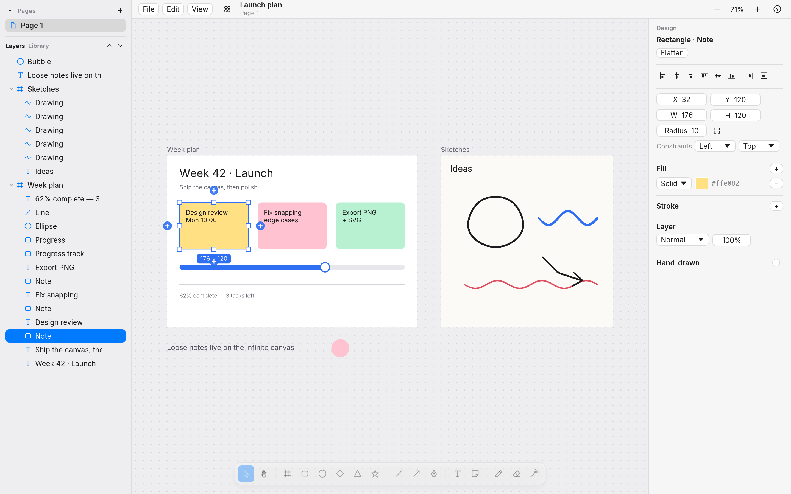
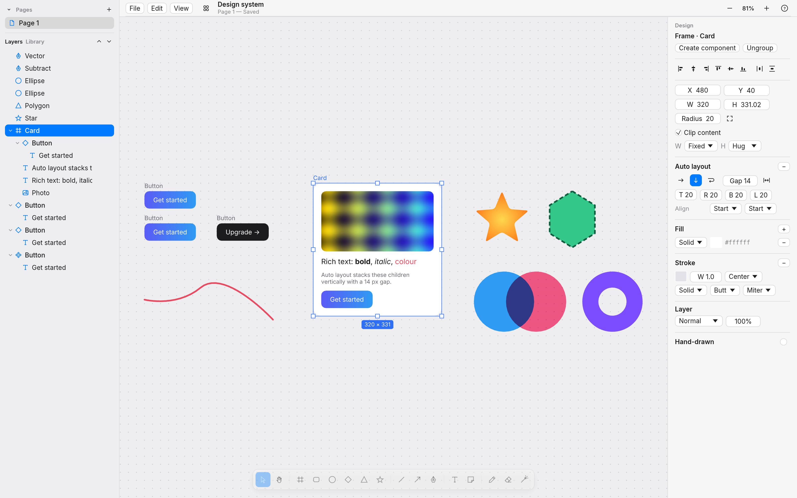
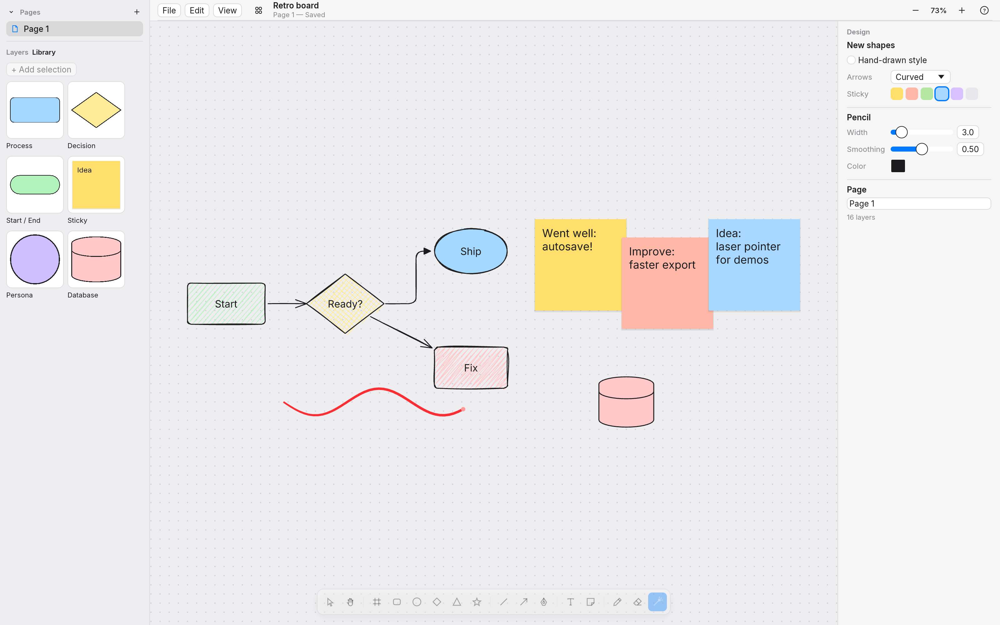

# paper-rs

A native Rust infinite canvas for planning, working and sketching. It is modeled on the
behavior of [Paper](https://paper.design) and built clean-room on `wgpu` + `winit` + `egui`.



A local-first design and whiteboard tool. Projects are folders of pages; each page is an
infinite canvas with frames, groups, components and instances, auto layout and constraints,
vector paths and booleans, gradients and image fills, rich text, smart guides, and
pressure-sensitive ink — plus a whiteboard mode: hand-drawn (rough.js-style) shapes, arrows that
bind to shapes and re-route, elbow connectors, sticky notes, a laser pointer and a shape
library. Everything autosaves, and exports to PNG and SVG.



> **Clean-room note.** `analysis/PAPER_ARCHITECTURE.md` documents how Paper Desktop 0.5.15 is
> put together, from a licensed install. The Electron package turned out to be a thin shell
> around the hosted web editor. paper-rs re-implements *behavior* only. No Paper code,
> shaders, icons, fonts or assets are used or committed. The UI and canvas text use
> [Inter](https://rsms.me/inter/) 4.1 (SIL OFL 1.1), bundled in `assets/fonts/`.

## Projects

paper-rs opens on a **home screen** of your projects (recents grid with thumbnails, New, Import,
and Rename / Duplicate / Move to Trash from each card's ⋯ menu or right-click; restore from
Trash). Each project is a plain folder in `~/Documents/paper-rs/<name>/` holding `project.json`
and one JSON file per page in `pages/`. Work is autosaved about a second after each change with
crash-safe atomic writes; files are versioned and older versions migrate on load. Set
`PAPER_RS_HOME` to use another folder.

A project has any number of **pages** (Pages list at the top of the left sidebar: + to add,
double-click to rename, right-click to duplicate or delete, drag to reorder). Each page is its
own infinite canvas with its own undo history and view. Copy and paste works between pages and
between projects.

## Build and run

You need Rust 1.95 or newer (`rust-version` in `Cargo.toml`; the latest stable is recommended). Install it with [rustup](https://rustup.rs).

```sh
cargo build --release
./target/release/paper-rs                  # projects home screen
./target/release/paper-rs --demo           # sample planning board (not saved)
./target/release/paper-rs ~/Documents/paper-rs/Plan   # open a project folder
./target/release/paper-rs board.paper-rs   # open a paper-rs 0.1 document
```

### macOS

```sh
xcode-select --install          # command line tools (linker)
curl https://sh.rustup.rs -sSf | sh
cargo build --release && ./target/release/paper-rs --demo
```

It uses Metal through wgpu. Shortcuts use ⌘, and trackpad pinch zooms. The macOS target is
type-checked in CI-style (`cargo check --target aarch64-apple-darwin`) but has not been run on
Mac hardware yet (see Known gaps).

### Linux

```sh
# Debian/Ubuntu runtime libraries (usually already present on desktops)
sudo apt install libxkbcommon-x11-0 libxcb-xkb1 libvulkan1 mesa-vulkan-drivers
cargo build --release && ./target/release/paper-rs --demo
```

It runs on X11 and Wayland through Vulkan, or GL as a fallback. Shortcuts use Ctrl. File
dialogs use the XDG desktop portal.

### Headless (servers, CI)

No display is needed. wgpu renders offscreen, through Mesa lavapipe when there is no GPU:

```sh
paper-rs --screenshot ui.png --demo --size 1440x900 --scale 2   # full UI
paper-rs --export-png out.png board.paper-rs --scale 2 [--transparent]
paper-rs --export-svg out.svg board.paper-rs
```

## Tests

```sh
cargo test                                # 51 unit/scenario tests + 8 headless GPU tests
PAPER_RS_REQUIRE_GPU=1 cargo test         # fail (instead of skip) when no GPU adapter exists
```

* **Unit tests** cover camera math, ink smoothing and pressure, text layout, snapping,
  transactions, serialization and SVG.
* **Scenario tests** (`src/editor/tests.rs`) drive the editor with synthetic pointer and
  keyboard events. They draw, create, select, drag, resize, snap, nudge, copy/paste, reparent,
  undo and redo.
* **Headless GPU tests** (`tests/headless.rs`) render each milestone through wgpu, assert pixel
  colors at known positions, and write the images below. One test rasterizes the SVG export
  with resvg and requires it to match the GPU PNG export: 0.004% of pixels differ, all on
  anti-aliased edges.

| Milestone | Screenshot(s) |
|---|---|
| 1. Infinite canvas, pan and zoom | `m1_canvas.png`, `m1_zoomed.png`, `m1_zoom_to_fit.png` |
| 2. Freehand sketch with smoothing | `m2_sketch.png` (smoothing 0, 0.5, 0.9; fast vs slow; pen pressure ramp) |
| 3. Shapes, frames, text | `m3_shapes_frames_text.png` (frame clipping, rounded rect, ellipse, line, text) |
| 4. Select/move/resize, multi-select, snapping | `m4_multi_select.png`, `m4_snapping.png` (live guides), `m4_resized.png` |
| 5. Layers panel and undo/redo | `m5_layers_edited.png`, `m5_layers_after_undo.png` |
| 6. Save/load and PNG/SVG export | `m6_launch_plan.paper-rs`, `m6_export_frame@2x.png`, `m6_export_all_transparent.png`, `m6_export.svg`, `m6_export_svg_via_resvg.png` |
| Real window (X11 under Xvfb, lavapipe) | `x11_window_xvfb.png` |

All of these are in `docs/screenshots/`.

## Using it



The tools sit in the floating bar at the bottom of the canvas. Select a layer to edit it in
the **Design** panel on the right. The **Layers** panel on the left shows the tree: click to
select, Shift-click to add, double-click to rename, and use 👁 / 🔒 to hide or lock. The
**Up/Down** buttons reorder.

* Draw a frame around existing shapes and it adopts them. Shapes drawn inside a frame become
  its children, and dragging a layer into or out of a frame re-parents it.
* Top-level frames that contain content act as canvas regions. Drag from their body to
  marquee-select inside them, and drag the frame by its name label.
* The pencil keeps a constant on-screen width at any zoom. With nothing selected, set width,
  smoothing and color in the Design panel.
* Hold ⌘/Ctrl while dragging to suspend snapping.

### Keyboard shortcuts

⌘ on macOS, Ctrl on Linux and Windows. Press `?` in the app for the full list.

| Keys | Action | Keys | Action |
|---|---|---|---|
| V | Select | ⌘Z / ⌘⇧Z / ⌘Y | Undo / redo |
| H, or hold Space | Hand (pan) | ⌘C / ⌘X / ⌘V | Copy / cut / paste |
| F or A | Frame | ⌘D | Duplicate |
| R | Rectangle | ⌘A | Select all (in scope) |
| O | Ellipse | Delete / Backspace | Delete |
| L | Line | ⌘] / ⌘[ | Forward / backward |
| T | Text | ⌘⇧] / ⌘⇧[ | To front / to back |
| P or B | Pencil (freehand) | ⌘⌥G | Wrap selection in frame |
| E | Eraser | ⌘⇧H / ⌘⇧L | Show/hide, lock/unlock |
| Enter | Edit text / select children | ←↑→↓ (⇧ = 10px) | Nudge |
| Esc | Cancel / select parent / deselect | ⌘' | Toggle snapping |
| ⌘= / ⌘- / ⌘0 | Zoom in / out / 100% | ⌘N / ⌘O | New / open |
| ⇧1 / ⇧2 | Zoom to fit / selection | ⌘S / ⌘⇧S | Save / save as |
| Wheel / ⌘+wheel / pinch | Pan / zoom | ⌘⇧E / ⌘⌥E | Export PNG / SVG |

These match Paper wherever Paper's shortcuts are visible: the desktop menu defines ⌘N, ⌘Z,
⌘⇧Z, ⌘X/C/V, ⌘A, and canvas zoom on ⌘+, ⌘-, ⌘0. Paper's tool hotkeys live in its web client,
so the tool letters follow the shared design-tool convention.

## Feature parity: Paper / Figma / Excalidraw vs paper-rs

Columns 2–4 say whether each product has the feature (✓) and where the behavior was learned:
Paper from its desktop shell and public docs (`analysis/PAPER_ARCHITECTURE.md`), Figma from
public docs (`analysis/FIGMA_NOTES.md`), Excalidraw from its MIT source
(`analysis/EXCALIDRAW_NOTES.md`). The last column is paper-rs: ✅ done, ⚠️ partial (see
Known gaps), ⏳ planned in a later milestone, ❌ not planned.

| Feature | Paper | Figma | Excalidraw | paper-rs |
|---|---|---|---|---|
| Local projects, recents grid, trash | (cloud dashboard) | ✓ (cloud) | (single file) | ✅ Folders in `~/Documents/paper-rs`, thumbnails, rename/duplicate/trash/restore |
| Autosave, crash-safe, versioned files | ✓ (cloud) | ✓ (cloud) | ✓ (browser storage) | ✅ 1 s autosave, atomic writes, migration chain (page v1→v3) |
| Pages, infinite canvas per page | ✓ | ✓ | – | ✅ Per-page history and camera, reorder/duplicate/delete |
| Frames with clipping | ✓ | ✓ | ✓ | ✅ ⚠️ clip is rectangular (corner radius not clipped) |
| Groups | ✓ | ✓ | ✓ | ✅ Bounds follow children, click selects group, double-click enters, scale on resize |
| Components, instances, overrides | – | ✓ | (library only) | ✅ Live sync, per-property overrides, reset, detach, go to main |
| Auto layout (direction, gap, padding, hug/fill/fixed, wrap) | ✓ (flexbox) | ✓ | – | ✅ Drag-reorder in flow, space-between, absolute children |
| Constraints | – | ✓ | – | ✅ Left/right/stretch/center/scale per axis, ⌘ to ignore |
| Pen tool, vector point editing | ✓ | ✓ | – | ✅ Corner/smooth points, handles (⌥ breaks), close, delete, toggle |
| Boolean ops (union/subtract/intersect/exclude), flatten | (roadmap) | ✓ | – | ✅ ⚠️ destructive (result is a path, curves flattened) |
| Gradients (linear, radial) | ✓ | ✓ | – | ✅ Multi-stop, angle, radius; ⚠️ no on-canvas gradient handles |
| Image fills | ✓ | ✓ | ✓ (image element) | ✅ Fill/fit/stretch/tile, place image (⌘⇧K), drag-and-drop, stored in project |
| Strokes: width, align, dash, caps, joins | ✓ | ✓ | ✓ | ✅ |
| Corner radius (per corner), polygons, stars | ✓ | ✓ | – | ✅ |
| Opacity, blend modes | ✓ | ✓ | ✓ (opacity) | ✅ ⚠️ canvas renders 5 modes exactly, all 16 exact in SVG |
| Rich text (per-range bold/italic/size/colour) | ✓ | ✓ | – | ✅ Plus underline, strikethrough, line height, letter spacing |
| Align / distribute | ✓ | ✓ | ✓ | ✅ ⌥A/D/W/S/H/V, ⌥⇧H/V |
| Smart guides, spacing, measurement | ✓ | ✓ | – | ✅ Edge/center snap, equal spacing, ⌥-hover distances |
| Hand-drawn (rough) style per element | – | – | ✓ | ✅ rough.js 4.6.4 port, verified against rough.js output; sloppiness, fill styles |
| Bound arrows, elbow arrows, quick shapes, sticky notes | – | (FigJam) | ✓ | ✅ Orbit binding that follows shapes, straight/curved/elbow, 5 heads, diamond, quick-connect, stickies |
| Laser pointer, shape library | – | (FigJam) | ✓ | ✅ Fading laser trail; shared library with starter items |
| Inspector, layers drag-reorder, command palette (⌘K) | ✓ | ✓ | ✓ | ⚠️ inspector done; ⏳ M5 for the rest |
| Export PNG / SVG / PDF of selection, frame, page | ✓ | ✓ | ✓ (PNG/SVG) | ⚠️ PNG/SVG done; ⏳ PDF in M6 |
| Import .excalidraw / SVG, copy-paste across projects | – | ✓ (SVG) | ✓ | ⚠️ cross-project paste done; ⏳ M6 |
| Freehand ink with pressure | – | (pencil) | ✓ | ✅ Smoothing, pressure, eraser |
| Multiplayer, cloud sync, plugins, MCP | ✓ | ✓ | ✓ | ❌ local-first by design |

## Known gaps

* **Paper's document model is HTML/CSS.** paper-rs uses geometric nodes with flexbox-like auto
  layout on frames; there are no variables, CSS export or code generation.
* **Rendering approximations.** Frame clipping is a rectangle (scissor), so rounded frames
  don't clip their corners. Group opacity multiplies into children instead of compositing the
  group. Overlay, color dodge/burn, hard/soft light, difference, exclusion, hue, saturation,
  color and luminosity blend as Normal on the canvas (they are exact in SVG export).
* **Booleans are destructive**: the result is a new vector path with flattened curves.
  Gradients are edited in the inspector only.
* **Not run on macOS hardware yet.** The macOS build type-checks and uses only portable APIs
  (Metal via wgpu, winit, rfd), but it has not been launched on a Mac. On Linux, the real
  window was exercised under Xvfb; the screenshot is `x11_window_xvfb.png`.
* **Pen pressure.** winit 0.30 does not expose tablet pressure for pen events that arrive as
  mouse input, which is common with macOS and Wacom tablets. Pressure comes from touch/pen
  `force` when the platform reports it. Otherwise it is simulated from stroke velocity.
* **Text** uses Inter (regular, bold, italic, bold italic) with no shaping, so there are no
  ligatures, complex scripts or RTL, and no font picker. IME preedit is not displayed
  (committed text works).
* **No rotation.** Nodes are axis-aligned boxes; rotated imports are baked into paths.
* **Undo granularity.** Document renames from the Design panel are not undoable, and the
  selection is not part of history.
* **Performance.** Nodes are tessellated once per zoom octave and cached; unchanged frames
  reuse the previous item list and GPU buffers, so panning uploads nothing. With 10k visible
  nodes a cached frame takes ~3 ms (release, `tests/perf.rs`); the first frame at a new zoom
  octave takes ~140 ms on a CPU. Not tuned for 100k+.
* **Linux file dialogs** need an XDG desktop portal. Without one, Save/Open dialogs return
  nothing. The headless CLI is unaffected.

## Project layout

```
src/geom.rs        vectors, rects, camera
src/vector.rs      bezier paths: flatten, hit test, SVG data, shapes, dashes
src/model/         Node / NodeKind / paints / Document arena
src/history.rs     transactions, undo/redo
src/layout.rs      auto layout, constraints, group bounds
src/ink.rs         stroke smoothing, pressure, outline
src/text.rs        rich text layout and glyph outlines
src/assets.rs      image registry (content-hashed)
src/project/       project store, manifest/page formats, migrations
src/session.rs     open project, autosave, thumbnails
src/editor/        tools, structure (groups/components), vector ops, pages, text editing
src/render/        draw ops → cached meshes → wgpu; headless capture
src/io/            PNG, SVG, atomic writes, imports
src/ui/            home screen, pages, layers, inspector
src/app.rs         winit application
analysis/          reverse-engineering findings and design (raw dumps are gitignored)
docs/screenshots/  headless renders produced by `cargo test`
```

## License

MIT OR Apache-2.0 for the code in this repository. Inter (Regular, Medium, SemiBold) is
© The Inter Project Authors under the SIL Open Font License 1.1; see `assets/fonts/OFL.txt`.
